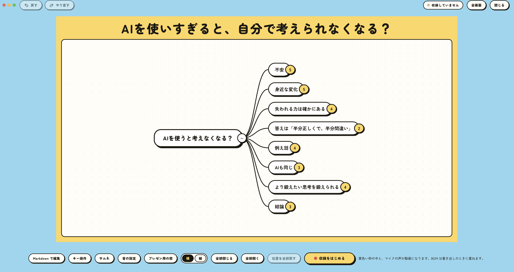
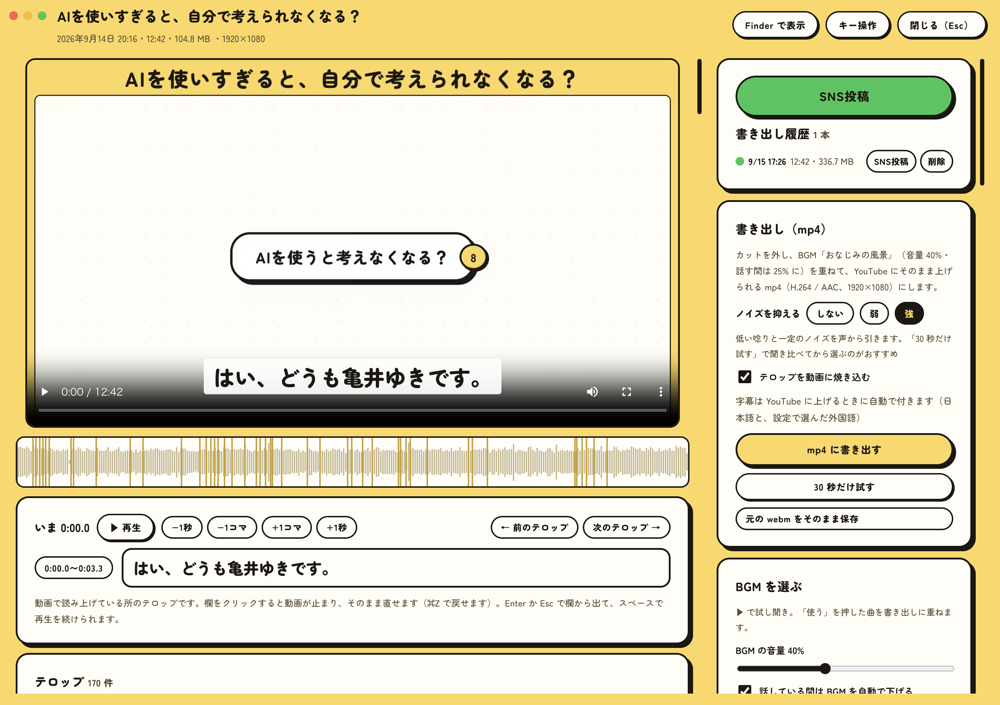
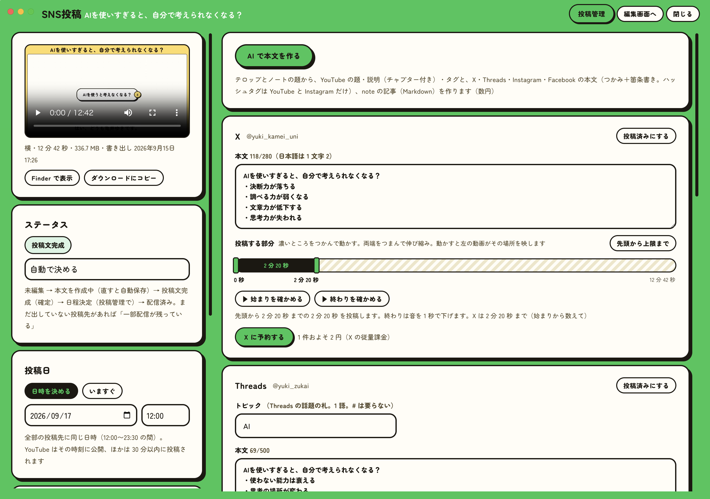
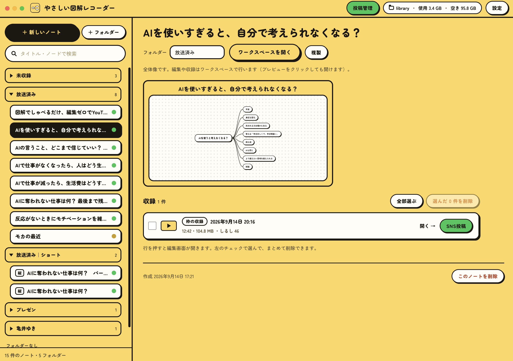
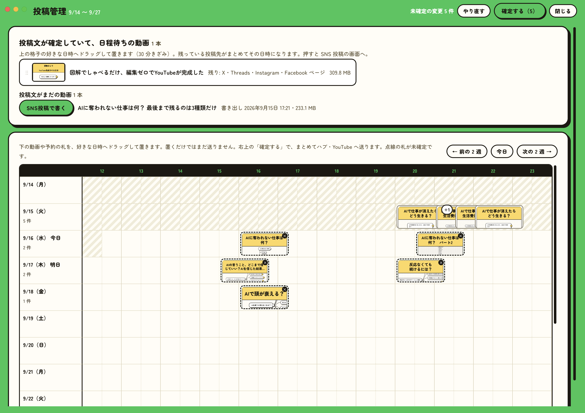
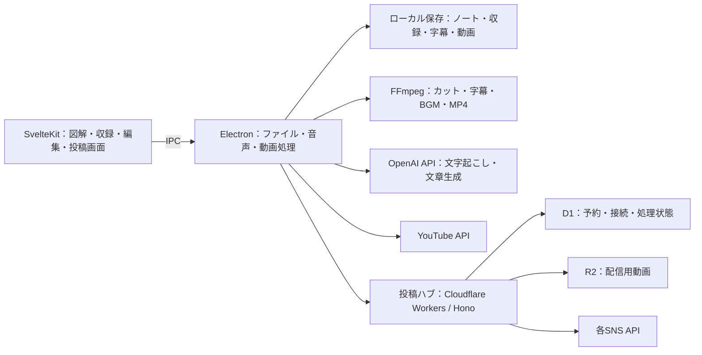

# やさしい図解レコーダー

**図で考え、話して録り、動画と記事にして届ける。**

図解・収録・動画編集・字幕・AIによる投稿文生成・SNS配信管理を一つにした、macOS向けの制作アプリです。自分の動画制作で使うために、企画・画面デザイン・設計・開発を一人で行いました。



## 作った理由

図解を見せながら説明した内容を、動画だけでなく、各SNSの投稿やnoteの記事にも展開したい。そのたびに別々のツールで編集・転記する手間を減らすために作りました。

一度の収録を起点に、図解、音声、字幕、書き出した動画、投稿文、配信予定をつなげています。実際の制作で使いながら、必要な機能を追加してきた個人利用のツールです。

[制作した動画を見る](https://www.youtube.com/@yuki_zukai) · [技術記事：Zenn](https://zenn.dev/moca) · [AI活用の実践：note](https://note.com/yuki_kamei_uni)

## 制作から配信まで

1. **話す内容を整理する** — Markdownからマインドマップを作成。図と文章を行き来して編集。
2. **図を動かしながら収録する** — 図解とマイク音声を収録。横動画・縦動画、プレゼン用の別ウィンドウに対応。
3. **動画を整える** — 波形を見ながらカットし、字幕を修正。BGM、音量調整、ノイズ低減を加えてMP4に書き出す。
4. **AIで文章を作る** — 題名と文字起こしをもとに、媒体ごとの投稿文・タグ・チャプターやnote記事を生成。
5. **内容を確認して配信する** — 投稿先ごとに本文や動画範囲を確認し、投稿・予約・配信状況を管理。

| 編集画面 | 投稿文と配信の設定 |
| --- | --- |
|  |  |

<details>
<summary>ノート一覧と投稿スケジュールを見る</summary>




</details>

## 投稿先と実装方式

| 投稿先 | このアプリでの扱い |
| --- | --- |
| YouTube | アプリからOAuth接続し、動画・字幕・サムネイルをアップロード。予約公開にも対応 |
| X / Threads / Instagram / Facebookページ | 投稿ハブを経由して、動画・本文の投稿と予約を管理 |
| TikTok | 投稿ハブの連携コードを実装。公開範囲は接続先の審査・権限に依存。未審査の設定では自分のみ |
| note | AIで記事を生成し、見出しなどを保った形でコピー。noteの編集画面への貼り付けと公開は手動 |

SNS機能を使うには、ご自身の開発者アカウント・OAuth設定と投稿ハブの配置が必要です。各サービスへの接続情報や既存の投稿データは含まれません。

## 技術と構成

**TypeScript / Svelte 5 / SvelteKit / Electron / Node.js / FFmpeg / OpenAI API / Cloudflare Workers / Hono / D1 / R2 / OAuth / Vitest**



### コードで見られる設計

- **画面・OS側の処理・共通ルールを分離** — `src/`、`electron/`、`shared/`に役割を分け、画面とElectronで共通の型を使っています。[共有する型](shared/types.ts) / [preload](electron/preload.ts)
- **長い収録を全量メモリにためない** — 収録データを小分けに送り、順番を保ってファイルへ追記。終了しなかった収録を次回起動時に回収する処理を備えています。[収録処理](electron/lib/recorder.ts)
- **編集内容と元データを分ける** — カット範囲を別データとして管理し、動画の書き出し時に反映します。[カット処理](shared/cuts.ts) / [書き出し](electron/lib/export.ts)
- **図とMarkdownを相互変換** — 再編集時にノードのID・位置・開閉状態をできるだけ保持。過去の形式やIDの重複にも読み込み時に対処します。[変換処理](shared/notes.ts) / [テスト](shared/notes.test.ts)
- **生成と公開を分ける** — AIが文章を生成したあと、人が内容を確認して投稿を決めます。媒体ごとの文字数や予約日時も共通ルールで扱います。[投稿ルール](shared/publish.ts) / [文章生成](electron/lib/publish/compose.ts)
- **予約の状態を持つ** — 待機・実行中・完了・失敗・取消の状態を持ち、投稿先ごとの処理と予約実行を分けています。[予約処理](hub/src/scheduler.ts) / [SNS連携](hub/src/platforms/)

## 開発でのAIの使い方

何を作るか、技術をどう組み合わせるか、画面と処理をどう分けるかを決め、AIを使って実装を進めました。設計では、制作の流れ、変更しやすい構造、処理速度、利用費用を重視しています。

このリポジトリでは、実際に使っているアプリのコード、仕様、既存のテストを公開しています。公開用に設定値と説明を整理したもので、過去の開発履歴は含みません。

## 起動する

macOSとNode.js 24系を用意してください。依存関係は`package-lock.json`で固定しています。

```bash
git clone https://github.com/mocayuki/yasashii-zukai-recorder.git
cd yasashii-zukai-recorder
npm ci
npm run dev
```

図の編集・収録・カット・動画書き出しはローカルで行います。マイクの利用にはOSの許可が必要です。

- 文字起こし・文章生成：アプリの設定でOpenAI APIキーを入力。
- YouTube連携：ご自身のGoogle Cloud OAuthクライアントを設定。
- その他のSNS：[`hub/README.md`](hub/README.md)を参照。公開版の`hub/wrangler.toml`は雛形なので、ご自身のURL・D1・R2に設定し直してください。

## 検証とビルド

```bash
npm run check     # Svelte / TypeScript
npm test          # 既存のユニットテスト
npm run build     # 画面とElectronのビルド
```

投稿ハブの型チェック：

```bash
cd hub
npm ci
npm run check
```

Macアプリの生成は`npm run package`、DMGの生成は`npm run dist`です。署名・公証済みの配布アプリではありません。

[公開準備時の検証結果](docs/VALIDATION.md)

## データと設定

ノート・収録・字幕・書き出しは、アプリが管理するローカルフォルダーに保存します。APIキーや接続情報はローカルの設定ファイルに保存する実装です。自分の端末で使うことを前提としています。

公開リポジトリには、認証情報、収録データ、利用者の設定、既存の投稿ハブの接続先は含めていません。

## 詳細

- [仕様書](docs/SPEC.md)
- [投稿ハブの設定](hub/README.md)
- [公開版の範囲](docs/PUBLICATION.md)

制作：**亀井 優希 / 株式会社UNI**
